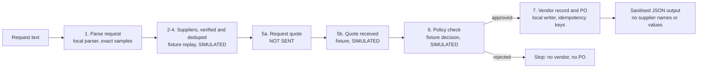

# Supplier agent: architecture and two-minute demo script

Every number and supplier in the demo is **SIMULATED** (fabricated fixture data). Nothing is sent to a supplier, no live Crustdata call is made by the offline demo, and no WhatsApp message is sent.

## What is wired together, and what is not

| Part | Code | Used by the offline demo? |
| --- | --- | --- |
| 1. Parse request | `src/intake/request-reader.cjs` | Yes (exact sample texts only) |
| 2–4. Find, verify, dedupe suppliers | `src/discovery/*.py` (Python) | No. Its fixture output is replayed from `samples/full-flow.cjs` |
| 5a. Request a quote | none | No. Shown as `NOT_SENT` |
| 5b. Receive quote | `src/quotes/quote.cjs` | No. Fixture quotes are replayed |
| 6. Policy check | `src/policy/policy.cjs` | No. A fixture decision stands in |
| 7. Vendor record and PO | `src/po/writer.cjs`, `src/state/idempotency.cjs` | Yes (local files, temp directory only) |

## Diagram



## Two-minute demo script

1. **(0:00–0:15) The problem.** A buyer needs 500 industrial temperature sensors, budget USD 25,000, delivery in 14 days. Today this is spreadsheets and phone calls.
2. **(0:15–0:35) Run it.** Open a terminal in the repo and run `node src/orchestrator.cjs`. Point to the top: `"label": "SIMULATED"` and `"mode": "OFFLINE_FIXTURE_ONLY"`.
3. **(0:35–1:05) Walk the steps.** Read the `steps` list in the output. Step 1 is parsed locally. Steps 2–6 are fixture replays and say so. Step 5a says `NOT_SENT`.
4. **(1:05–1:25) Show the safety rules.** Point to the citations (field names and endpoints only, with `SIMULATED fixture` in every line). No supplier name or company value appears on screen.
5. **(1:25–1:45) Show the idempotency.** Run the same command again. Both records report `EXISTS` and nothing is written twice.
6. **(1:45–2:00) Close honestly.** "The live path needs a Crustdata key and a supplier-outreach decision. Neither is in this demo. Everything shown is simulated."

## Run the checks

```powershell
node src/orchestrator.cjs
node --test src/intake/request-reader.test.cjs src/state/idempotency.test.cjs src/po/writer.test.cjs tests/e2e.cjs tests/quotes-policy.test.cjs
python -m unittest discover -s tests -p "crustdata_*_test.py"
python demo_citations.py
```

The Node suite skips one test (test 10) when the checkout sits under the OS temporary directory. Run it from a checkout outside the temp folder to execute that test too.
