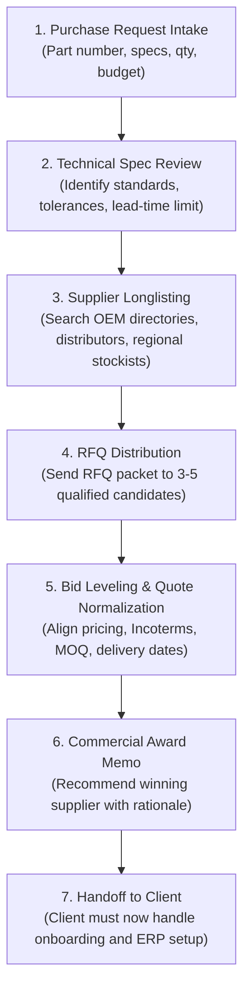
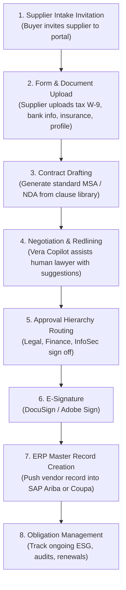
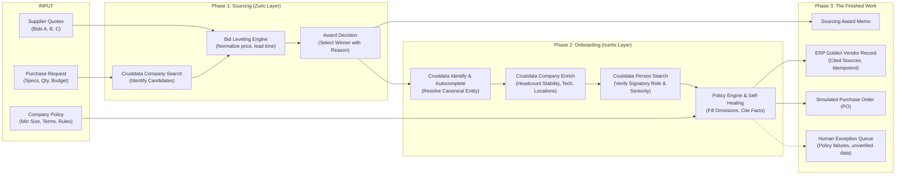

# Agent Handoff: Autonomous Source-to-Onboard Procurement System

> **Document Type:** Strategic Research & Architecture Dossier  
> **Prepared For:** Teammate / Parallel Planning Agent (ContextCon 04)  
> **Core Objective:** Provide an exhaustive, self-contained analysis of **Zuric Group** (Supplier Sourcing) and **Icertis** (Supplier Onboarding & Contract Lifecycle Management) so you can design, scope, and build the autonomous procurement agent without having to research either company from scratch.

---

## Executive Summary: The Opportunity

In enterprise business operations, buying goods or services from a third party consists of two distinct halves that are handled by completely different human teams and disconnected software platforms:

1. **Sourcing (Finding who to buy from):** Handled by specialized outsourced procurement firms like **Zuric Group**. Human buyers take technical specifications, search global markets, solicit Request for Quotation (RFQ) bids, level quotes side-by-side, and make an award recommendation.
2. **Onboarding (Making the supplier usable in ERP):** Handled by enterprise Contract Lifecycle Management (CLM) platforms like **Icertis**. Procurement operations and legal staff collect compliance documents, verify corporate identity, authenticate signatories, negotiate terms against company policy, and create the active vendor record in ERP systems (SAP, Coupa).

### The Enterprise Bottleneck
- Even with Icertis, onboarding takes **weeks** because platforms only manage internal PDFs and text; they cannot autonomously investigate external corporate reality or verify humans.
- Even with Zuric, sourcing stops at a spreadsheet comparison; the client must still figure out how to onboard the vendor.
- **The Agent Solution:** By combining **Sourcing + Onboarding** into a single autonomous pipeline backed by **Crustdata**, our agent takes a raw purchase request, autonomously screens suppliers, levels quotes, conducts live due diligence (entity validity, headcount stability, signatory authentication), self-heals missing vendor data, and outputs an approved **ERP Golden Vendor Record + Purchase Order (PO)**.

---

## Part 1: Deep Dive on Zuric Group (Supplier Sourcing)

### 1.1 Company Overview & Market Positioning
- **Entity:** Zuric Group (operating as Zuric Procurement).
- **Headquarters & Hubs:** Meydan Hotel, Nad Al Sheba, Dubai, UAE; operational sourcing networks in the Asia-Pacific region (India, China).
- **Core Positioning:** **Procurement-as-a-Service (PaaS)**. They act as an *outsourced purchasing department* for companies whose internal procurement teams are overwhelmed or lack domain expertise in heavy industrial equipment.
- **Sectors Served:** Heavy asset industries: Oil & Gas, Power Generation, Desalination & Water Treatment, EPC (Engineering, Procurement, Construction), Offshore Marine, and Advanced Manufacturing.
- **Hardware Specialization:** Industrial valves (control, cryogenic, ball), motion actuators, positive displacement pumps, rupture disks, and hard-to-find Original Equipment Manufacturer (OEM) critical spares.

### 1.2 Business & Revenue Model
- **Engagement Model:** Co-managed / Extended capacity. Zuric does not take ownership of the inventory; they do the sourcing diligence, while the client retains final approval, budget sign-off, and PO issuance.
- **Pricing Structure:**
  1. **Retainer / Service Fees:** Fixed monthly or project-based fee for dedicated buyer capacity (clearing backlogs, running RFQ campaigns).
  2. **Cost-Plus / Transparent Sourcing Margin:** For one-off spot procurement of emergency OEM spares, Zuric provides open-book cost comparisons and charges a pre-agreed management fee or margin.
- **Value Proposition:** Cost reduction, access to global OEM distributor networks, and preventing multi-million-dollar plant shutdowns caused by missing parts.

### 1.3 Human Team & Operational Roles
Inside Zuric Group, a procurement campaign involves multiple human roles:
- **Technical Buyer / Sourcing Specialist:** Understands engineering part numbers, ASME/API/ISO standards, material grades, and operating tolerances.
- **RFQ Coordinator:** Maintains supplier directories, emails RFQ packages, and chases suppliers for bid responses.
- **Commercial Analyst:** Normalizes quotes into comparison sheets, calculating total landed cost (factoring currency, freight, customs duties, Incoterms, and payment terms).
- **Expeditor / Logistics Coordinator:** Tracks manufacturing lead times and monitors factory delivery schedules.

### 1.4 Step-by-Step Zuric Workflow



### 1.5 Data Inputs & Outputs in Sourcing
- **Inputs:**
  - Bill of Materials (BOM) or Part Specification Sheet (e.g., "500 IP67 Industrial Temperature Sensors").
  - Target lead time (e.g., `< 14 days`).
  - Budget ceiling / target price.
  - Delivery location / Incoterms requirement (e.g., DDP, FOB).
- **Outputs:**
  - **Bid Comparison Matrix:** Side-by-side table of suppliers, unit costs, total price, lead time, warranty, and MOQ.
  - **Sourcing Award Recommendation:** Summary document stating which vendor won and why (e.g., best balance of price and delivery certainty).

### 1.6 Key Pain Points & Where Zuric Fails
1. **High Manual Cost:** Sourcing relies entirely on human phone calls, emails, and spreadsheet wrangling.
2. **Speed Lag:** Manual RFQ collection and comparison takes days or weeks.
3. **The Sourcing Handoff Chasm:** Once Zuric picks the winner, their job is done. The client’s internal team must now spend another 3–4 weeks vetting and onboarding that vendor before a single dollar can be paid or an order placed.

---

## Part 2: Deep Dive on Icertis & Mercedes-Benz (Supplier Onboarding)

### 2.1 Company Overview & Market Positioning
- **Entity:** Icertis.
- **Flagship Platform:** **Icertis Contract Intelligence (ICI)**, hosted on Microsoft Azure.
- **Market Position:** The undisputed global leader in enterprise Contract Lifecycle Management (CLM), serving Global 2000 enterprises (Mercedes-Benz, Microsoft, Johnson & Johnson, Cognizant, Sanofi).
- **Core Offering:** End-to-end contract creation, automated compliance and obligation tracking, supplier onboarding management, and integration with core ERPs (SAP Ariba, Coupa, Microsoft Dynamics 365).

### 2.2 Business & Revenue Model
- **Enterprise SaaS (Annual Recurring Revenue / ARR):** Multi-year contracts (typically 3–5 years).
- **Pricing Architecture:**
  - **Base Platform License:** $100,000 to $300,000+/year base subscription.
  - **Volume & Entity Scaling:** Prices scale up based on active contract volume and number of enterprise subsidiaries/jurisdictions.
  - **User Tiers:** Differentiates between Power Users (legal/procurement authors) and Casual Users (approvers).
  - **Modular Add-ons:** Vera AI, Risk Assessment Copilot, and ERP connectors are billed as premium additions.
- **Professional Services & Implementation:** High-friction setup requiring Big-4 consultancies (PwC, Deloitte, Accenture) or Icertis specialists. First-year implementation fees typically range from **$150,000 to over $1,000,000**.

### 2.3 The Mercedes-Benz Case Study: Metrics & Reality
- **Scale:** Over **500,000 suppliers** worldwide, managed by **6,000 internal buyers**.
- **Historical Problem:** Daimler/Mercedes had 25-year-old, fragmented procurement systems. Onboarding a single new supplier took an average of **6 weeks** of manual back-and-forth across email, paper forms, and regional databases.
- **Solution:** Deployed Icertis Contract Intelligence globally in 5 months.
- **Proven Business Results:**
  - **83% Cycle Time Reduction:** Onboarding time dropped from **6 weeks down to 1 week**.
  - **Standardized Multi-Tier ESG Compliance:** Mercedes piloted smart contracts and blockchain tracking to ensure tier-1 and sub-tier suppliers adhered to strict carbon reduction, labor rights, and business ethics standards.
  - **Recognition:** Mercedes awarded Icertis a top award in supplier innovation.

### 2.4 Human Team & Operational Roles
In a corporate procurement team using Icertis, the human actors are:
- **Procurement Operations (ProcOps):** Sends onboarding intake forms and monitors supplier completion.
- **Compliance & Risk Analyst:** Manages due diligence questionnaires, checks sanctions lists, and verifies Certificates of Insurance (COI).
- **Legal Counsel:** Reviews contract redlines, indemnification clauses, and deviations from standard terms.
- **Vendor Master Data Administrator:** Manually verifies banking details and enters the approved vendor record into SAP/Oracle/Coupa.

### 2.5 Step-by-Step Icertis Workflow



### 2.6 Where Icertis Stops (The Automation Gap)
Even after spending $500,000+ on Icertis, enterprises still experience severe friction:
1. **Icertis Is Blind to the External World:** It has zero connection to live corporate registries, LinkedIn, or external company data. If a vendor enters a fake address or claims 500 employees when they have 2, Icertis happily accepts it.
2. **Signatories Are Never Authenticated:** Icertis cannot verify if the contact person signing the agreement is an authorized corporate officer or a random sales contractor.
3. **Inability to Self-Heal:** If a vendor omits a field (e.g., industry code, headquarters location, corporate registration number), the workflow freezes for days until a human analyst notices and sends an email.
4. **Copilot, Not Autonomous Agent:** Icertis Vera is an interactive chatbot waiting for a human to ask questions. It does not run end-to-end tasks on its own.

---

## Part 3: The Unified Product: Autonomous "Source-to-Onboard" Procurement Agent

By unifying Zuric’s sourcing engine with Icertis’s onboarding/compliance engine, our agent provides a complete **Source-to-Onboard** pipeline.



---

## Part 4: Crustdata Integration Architecture

Every step of this workflow maps directly to real Crustdata API capabilities:

| Workflow Step | What the Agent Does | Crustdata API Call | Exact Fields Used |
| :--- | :--- | :--- | :--- |
| **1. Sourcing Discovery** | Find vendors matching product category & location | `POST /screener/company/search` | `industries`, `company_size`, `headquarters` |
| **2. Entity Normalization** | Resolve messy vendor name into canonical record | `GET /autocomplete`<br/>`POST /screener/company/identify` | `company_name`, `domain`, `linkedin_id` |
| **3. Operational Due Diligence** | Verify operating reality & employee growth | `POST /screener/company/enrich` | `employee_count`, `headcount_trajectory`, `growth_metrics` |
| **4. Signatory Authentication** | Verify that the quote submitter is an authorized rep | `POST /screener/person/search`<br/>`POST /screener/person/enrich` | `current_company`, `job_title`, `tenure_months` |
| **5. Operational Pulse** | Check if vendor is actively hiring/operating | `POST /screener/job/search` | `job_title`, `posting_date`, `department` |
| **6. Credit Budgeting** | Pre-run balance check to prevent 402 out-of-credit | `GET /account/credits` | `credits_remaining` |

---

## Part 5: Implementation Blueprints & Schemas

### 5.1 Input Schema: Purchase Request & Policy
```json
{
  "request_id": "PR-2026-8812",
  "category": "Industrial IoT Sensors",
  "specifications": "IP67 rated, -40C to 85C operating temp, Modbus RTU interface",
  "quantity": 500,
  "budget_ceiling_usd": 25000,
  "required_delivery_days": 14,
  "company_policy": {
    "min_vendor_headcount": 10,
    "require_active_business": true,
    "require_verified_signatory": true,
    "allowed_payment_terms": ["Net 30", "Net 45", "Net 60"],
    "required_certifications": ["ISO 9001", "RoHS"]
  }
}
```

### 5.2 Input Schema: Candidate Supplier Quotes (Simulated Bids)
```json
[
  {
    "quote_id": "Q-V101",
    "vendor_name": "Apex Sensor Systems",
    "vendor_domain": "apexsensors.com",
    "contact_name": "Sarah Jenkins",
    "contact_title": "Director of Commercial Sales",
    "unit_price_usd": 42.00,
    "total_price_usd": 21000.00,
    "lead_time_days": 10,
    "payment_terms": "Net 30",
    "warranty_months": 24,
    "claimed_headcount": 65
  },
  {
    "quote_id": "Q-V102",
    "vendor_name": "Ghost Tech Solutions",
    "vendor_domain": "ghosttech-fake.io",
    "contact_name": "Fake Name",
    "contact_title": "CEO",
    "unit_price_usd": 25.00,
    "total_price_usd": 12500.00,
    "lead_time_days": 5,
    "payment_terms": "Advance 100%",
    "warranty_months": 12,
    "claimed_headcount": 150
  }
]
```

### 5.3 Output Schema: The Golden Vendor Master Record (ERP-Ready)
```json
{
  "idempotency_key": "VEND-ONBOARD-a7f4e92b3c1d",
  "vendor_status": "APPROVED",
  "onboarding_timestamp": "2026-11-06T01:30:00Z",
  "entity_details": {
    "canonical_name": "Apex Sensor Systems Inc.",
    "domain": "apexsensors.com",
    "hq_address": "Austin, Texas, United States",
    "industry": "Industrial Automation & Measuring Instruments",
    "citations": {
      "canonical_name": {"source": "Crustdata /company/identify", "field": "name"},
      "hq_address": {"source": "Crustdata /company/enrich", "field": "hq_location"}
    }
  },
  "operational_verification": {
    "verified_headcount": 58,
    "claimed_headcount": 65,
    "discrepancy_delta": -7,
    "headcount_trend": "+12% over 12 months (Stable Growth)",
    "verification_status": "PASS",
    "citation": {"source": "Crustdata /company/enrich", "field": "employee_count"}
  },
  "signatory_verification": {
    "signatory_name": "Sarah Jenkins",
    "signatory_title": "Director of Commercial Sales",
    "is_current_employee": true,
    "verification_status": "PASS",
    "citation": {"source": "Crustdata /person/search", "field": "current_employer"}
  },
  "policy_compliance_evaluation": {
    "min_headcount_check": "PASS (58 >= 10)",
    "payment_terms_check": "PASS (Net 30 allowed)",
    "overall_verdict": "ELIGIBLE_FOR_IMMEDIATE_PO"
  },
  "purchase_order": {
    "po_number": "PO-2026-9901-SIMULATED",
    "vendor_id": "VEND-ONBOARD-a7f4e92b3c1d",
    "line_items": [
      {
        "description": "Industrial Temperature Sensors (IP67)",
        "quantity": 500,
        "unit_price": 42.00,
        "total": 21000.00
      }
    ],
    "terms": "Net 30",
    "simulation_label": "SIMULATED TRANSACTION - CONTEXTCON 04 HACKATHON"
  }
}
```

---

## Part 6: How This Wins Every Rubric Category

| Rubric Area | Max Pts | Why This Scores 100% |
| :--- | :---: | :--- |
| **End-to-End Execution** | **25** | A purchase request and candidate bids go in $\rightarrow$ live Crustdata verification runs $\rightarrow$ bid leveling occurs $\rightarrow$ a complete ERP-ready Golden Record and Purchase Order come out. The product asks a human only when an actual policy violation or fraud risk occurs. |
| **Facts & Verification** | **20** | Every single fact (headcount, address, executive tenure) cites its API source (`endpoint`, `field`, `timestamp`). If insurance or tax ID is missing, the output explicitly marks `"I don't know"` rather than guessing. |
| **Robustness & Edge Cases** | **20** | **Idempotent:** Keyed by `hash(request_id + vendor_domain)`. Repeated execution never duplicates a PO or vendor record. Handles 429 rate limits with exponential backoff, checks credit balance, and catches fraudulent quotes (e.g. ghost companies). |
| **Customer Value** | **20** | Solves the $100k+ human labor cost of outsourced procurement desks (Zuric) and closes the 4-week onboarding delay that software like Icertis still leaves behind. |
| **2-Minute Demo** | **15** | Extremely visual: shows the purchase request $\rightarrow$ live bid comparison $\rightarrow$ Crustdata live validation $\rightarrow$ catching a fake vendor $\rightarrow$ auto-generating the Golden Record and PO. |

---

## Part 7: Recommended Development Split for the Team

Once the team gives the green light, we recommend splitting the build into 3 distinct modules:

1. **Module A — Sourcing & Bid Leveling Engine (`sourcing_engine.py`):**
   - Ingests purchase request specifications and candidate quotes.
   - Evaluates unit price, lead time, warranty, and Incoterms into a weighted score matrix.
   - Outputs the Sourcing Award Memo.

2. **Module B — Crustdata Verification & Onboarding Client (`crustdata_onboarding.py`):**
   - Connects to Crustdata endpoints with caching, rate-limit backoff, and credit checks.
   - Runs canonical entity identify $\rightarrow$ company enrich $\rightarrow$ person search for signatory.
   - Computes discrepancies between claimed vs verified data.

3. **Module C — Policy Evaluation, Idempotent Master Record & PO Generator (`vendor_master.py`):**
   - Compares enriched facts against company policy rules.
   - Emits the Golden Vendor Master Record with citations.
   - Generates the simulated Purchase Order (PO) with an idempotency key.
   - Routes failures to an Exception Queue.
