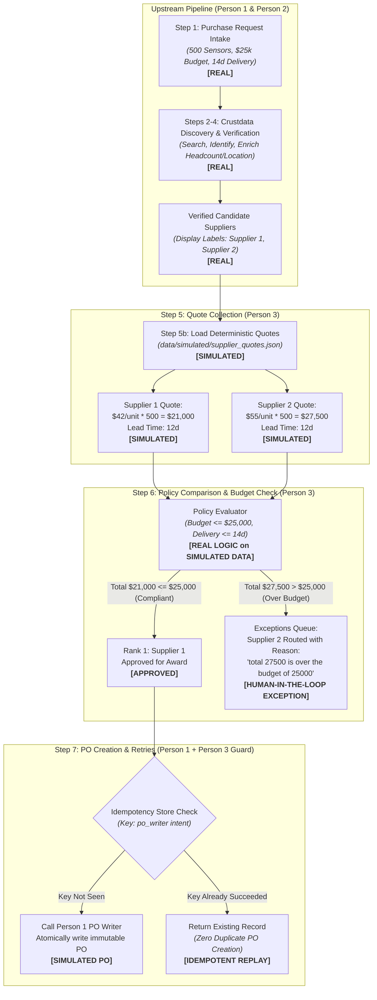
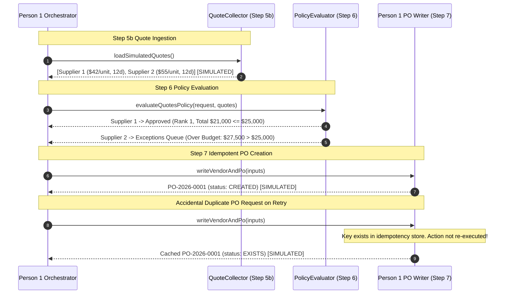

# Supplier Sourcing & Procurement Agent — Workflow Architecture

**ContextCon 04 Hackathon**  
**Role:** Person 3 (`debugat2am`) — Quotes, Policy, PO Retries  
**Scope:** Steps 5a, 5b, 6, and PO retry / idempotency guard coordination (Step 7).

---

## 1. End-to-End Pipeline & Simulation Boundaries

---

## 2. Sequence Diagram: Quotes, Policy Evaluation & Idempotent Retries

---

## 3. Strict Truthfulness & Simulation Disclaimers

1. **Quotes:** All quotations, pricing (\$42 / \$55), and delivery timelines are deterministic synthetic fixtures from `data/simulated/supplier_quotes.json` and carry the mandatory `"label": "SIMULATED"`.
2. **Purchase Orders:** All PO numbers (e.g. `PO-2026-XXXX`) and vendor onboarding records are synthetic demonstrations for ContextCon 04. No external ERP or cellular network was contacted.
