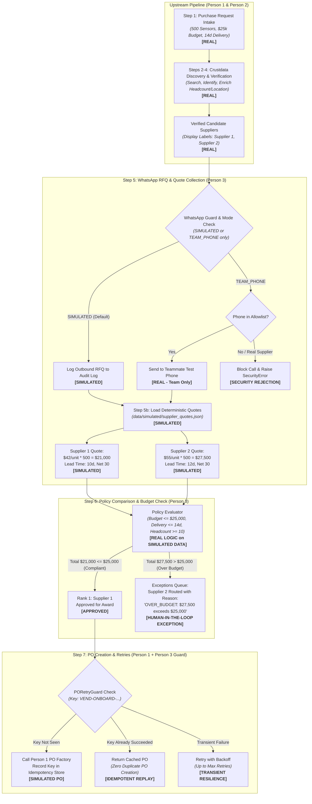
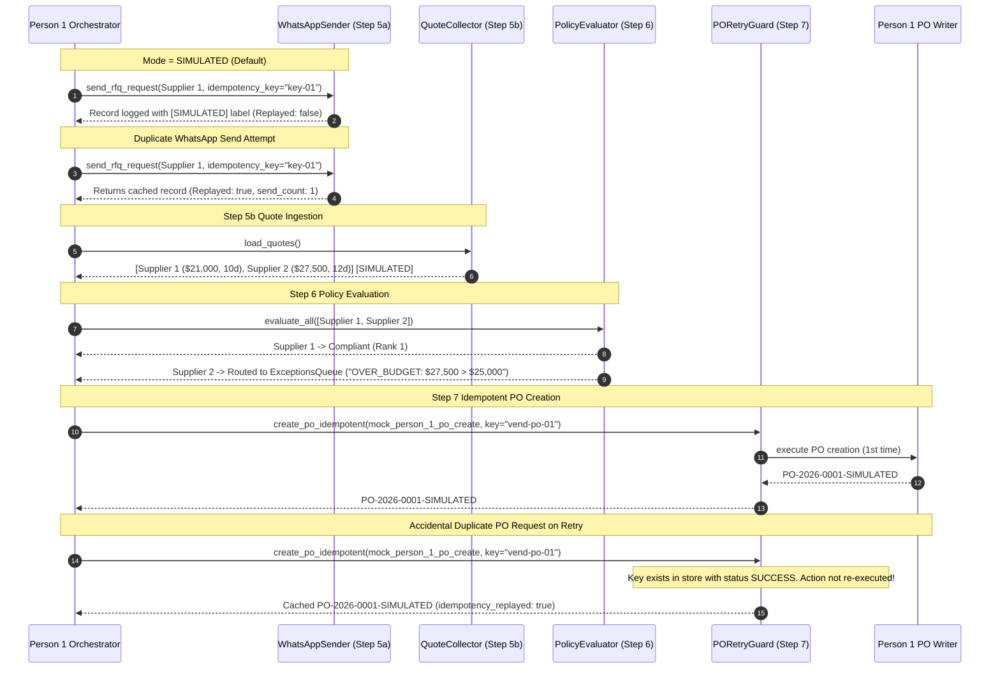

# Supplier Sourcing & Procurement Agent — Workflow Architecture

**ContextCon 04 Hackathon**  
**Role:** Person 3 (`debugat2am`) — Quotes, Policy, WhatsApp, PO Retries  
**Scope:** Steps 5a, 5b, 6, and PO retry / idempotency guard coordination (Step 7).

---

## 1. End-to-End Pipeline & Simulation Boundaries

---

## 2. Sequence Diagram: WhatsApp Dispatch, Policy Evaluation & Idempotent Retries

---

## 3. Strict Truthfulness & Simulation Disclaimers

1. **WhatsApp Messages:** All supplier outreach is strictly **SIMULATED**. Only test communication between designated team phones is permitted under `TEAM_PHONE` mode.
2. **Quotes:** All quotations, pricing ($42 / $55), and delivery timelines are deterministic synthetic fixtures from `data/simulated/supplier_quotes.json` and carry the mandatory `"label": "SIMULATED"`.
3. **Purchase Orders:** All PO numbers (e.g. `PO-2026-0001-SIMULATED`) and vendor onboarding records are synthetic demonstrations for ContextCon 04. No external ERP or cellular network was contacted.

